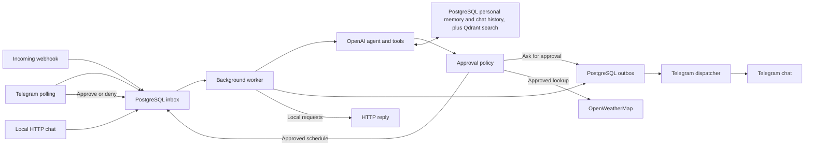

# Always-on AI agent

A Bun worker that accepts Telegram messages and authenticated webhook events. It answers questions and asks for approval before looking up current weather, scheduling a one-time weather update, or relaying a webhook payload.



## Run locally

```bash
bun install
cp .env.example .env
docker compose up -d --wait
bun run start
```

Before starting Bun, fill in `OPENAI_API_KEY` and `OPENWEATHER_API_KEY` in `.env`. For Telegram, create a bot with [BotFather](https://t.me/BotFather), set `TELEGRAM_BOT_TOKEN`, and start a private chat with it. Only one Bun process should poll a given bot token. If the bot was already set up to receive Telegram webhooks, use a separate bot token or disable its existing webhook before running the poller. To restrict your bot to specific private chats, set `TELEGRAM_ALLOWED_CHAT_IDS` to a comma-separated list of numeric chat IDs.

| Setting                    | Default or purpose                                    |
| -------------------------- | ----------------------------------------------------- |
| `OPENAI_MODEL`             | `gpt-5.4-mini`                                        |
| `DATABASE_URL`             | Matches the local PostgreSQL service in Compose       |
| `QDRANT_URL`               | `http://127.0.0.1:6333`                               |
| `PORT`                     | `3000` on localhost                                   |
| `AGENT_TIMEZONE`           | `Asia/Kolkata` for times without an explicit timezone |
| `WEBHOOK_SECRET`           | Shared bearer secret for incoming webhooks            |
| `WEBHOOK_TELEGRAM_CHAT_ID` | Fixed Telegram destination for webhook notifications  |

To run the Bun worker under Docker's restart policy, use the `agent` profile in place of `bun run start`. The worker reads the same `.env` and connects to PostgreSQL and Qdrant over the Compose network.

```bash
docker compose --profile agent up -d --wait
```

## Try it in Telegram

1. Send `/remember weather city = Mumbai, India`.
2. Ask “What’s the weather?” The bot includes the resolved city in the approval prompt. Tap **Approve** to allow the lookup.
3. Ask “Send me the weather at 5 p.m.” The bot asks you to approve the city, date, time, and timezone. This one approval covers creating the timer, fetching weather when it’s due, and delivering it to the same chat.
4. Send `/memories` to see your latest saved facts and preferences.

You can also say “Remember that my preferred name is Sam.” Use the same label to update a saved preference. The bot loads the latest 20 preferences from PostgreSQL for that chat. Qdrant continues to retrieve similar past conversations within the same chat. When you supply a city or another preference in a request, it takes priority for that request.

Approval requests expire after 15 minutes. A scheduling request also expires when its proposed time arrives. Deny closes the request, and each approval applies to one action. Times without an explicit timezone use `AGENT_TIMEZONE`.

Local HTTP chat is also available for testing the agent and weather tool.

```bash
curl -fsS http://127.0.0.1:3000/health
curl -fsS http://127.0.0.1:3000/chat \
  -H 'Content-Type: application/json' \
  -d '{"message":"What is the current weather in Mumbai, India?"}'
```

Local chat returns its reply over HTTP. For weather, send the exact `/approve <id>` or `/deny <id>` command printed in the JSON reply as a new `message` to `POST /chat`. Persistent preferences and scheduling are available in Telegram.

## Receive external events

Set both webhook settings in `.env` and start a chat with the bot at the configured destination. After the bot replies to a Telegram message, you can look up that chat ID in the local PostgreSQL database.

```bash
docker compose exec postgres psql -U agent -d agent -c 'SELECT DISTINCT chat_id FROM conversation_turns;'
```

Register `POST /webhooks/<source>` with an event provider or a bridge that can send the bearer header. For an external provider, make this route reachable through an HTTPS reverse proxy or tunnel. Keep PostgreSQL, Qdrant, and the local chat endpoint on localhost.

```bash
curl -fsS http://127.0.0.1:3000/webhooks/orders \
  -H "Authorization: Bearer ${WEBHOOK_SECRET}" \
  -H 'Content-Type: application/json' \
  -H 'Idempotency-Key: order-123-created' \
  -H 'X-Event-Type: order.created' \
  -d '{"orderId":"123","status":"created"}'
```

The endpoint returns `202` after PostgreSQL stores the payload. Reuse the same `Idempotency-Key` when retrying the same event and use a new key for a new request. Without a key, each request creates a new event. For ordinary events, the worker asks permission to relay the payload as plain text. The destination must be a private chat that can interact with the bot.

### Request weather from a webhook

Use the `weather.requested` event type with a top-level `city` and, when known, `countryCode`. A US `stateCode` can disambiguate cities with the same name.

```bash
curl -i http://127.0.0.1:3000/webhooks/weather \
  -H "Authorization: Bearer ${WEBHOOK_SECRET}" \
  -H 'Content-Type: application/json' \
  -H 'Idempotency-Key: weather-mumbai-002' \
  -d '{"type":"weather.requested","city":"Mumbai","countryCode":"IN"}'
```

The Telegram prompt names the city and webhook source. After approval, the worker fetches the current conditions from OpenWeatherMap and sends them to that Telegram chat. Invalid weather payloads return `400` before anything is queued.

## Storage and delivery

- **PostgreSQL** is the source of truth for events, scheduled jobs, outgoing messages, and conversation turns. An approved scheduling request commits the future event and confirmation together. Pending approvals and their decisions are durable.
- **Qdrant** indexes completed Telegram turns using OpenAI embeddings. Retrieval is scoped to the same chat. Recent PostgreSQL history remains available while Qdrant or the embedding API is unavailable.
- **Retries** use PostgreSQL leases and backoff. Pending work survives process restarts. Delivery resumes when Bun is running again, so a timer due during downtime runs after startup. Telegram delivery can repeat if Telegram accepts a message just before a crash and before PostgreSQL records it.
- **Approval policy** binds each decision to the originating Telegram chat or the localhost approval code. Before running an existing timer created before this policy, the worker asks for weather lookup approval when that timer comes due.

PostgreSQL and Qdrant keep their data in Compose named volumes. Timely delivery requires the worker and its host to be running when the event is due.

## Extend and verify

- `index.ts` wires the runtime, HTTP routes, and workers.
- `src/events/` owns the inbox, worker, outbox, and memory indexing.
- `src/channels/telegram.ts` handles Telegram input and output.
- `src/tools/` defines current weather and scheduled weather delivery.

```bash
bun run typecheck
bun test
```

The tests use simulated API responses and run without credentials. Weather data comes from [OpenWeatherMap](https://openweathermap.org/api/current).
